# GRIDTRACE — Every gap tells a story

**Interactive motorsport race-analysis platform.** Historical F1 race replay with broadcast-grade race control, a 3D circuit stage, position/gap timing, distance-aligned telemetry battles, and six analytical engines — all driven by one shared replay clock.

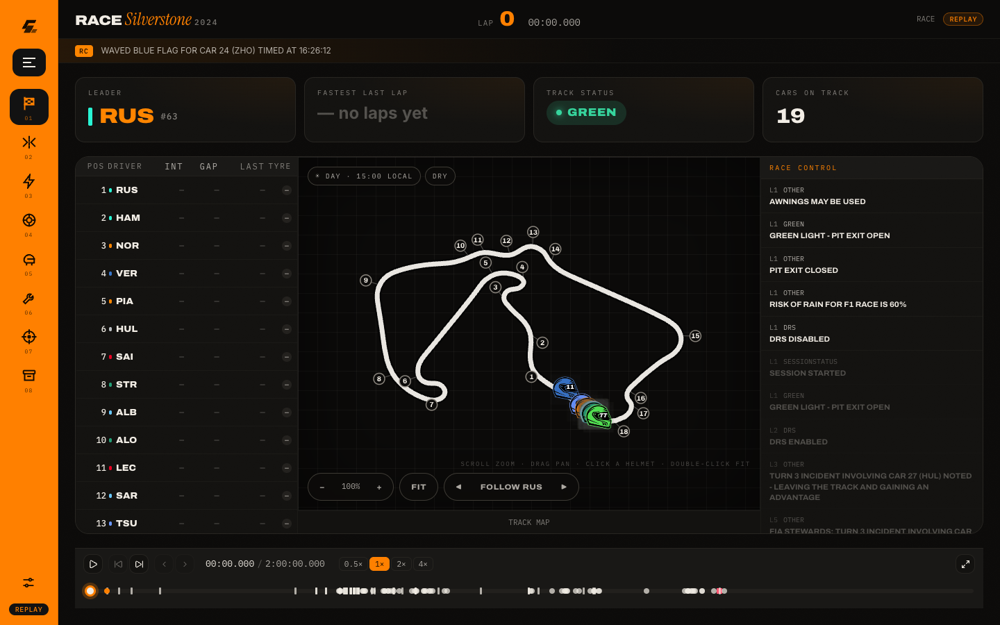

> **Live (production):** **https://gridtrace.vercel.app**
> App at `/app` (`/` redirects straight to the app) · marketing landing at `/landing` · API under `/api/*` (all `REPLAY` data).
> Deployed from `ashwinwork` — this alias always serves the latest production build. If you see an old UI, hard-refresh (Cmd/Ctrl+Shift+R).

**Branch:** `ashwinwork` (app development; `main` remains the static GitHub Pages site)
**Repo:** `git@github.com:EchelonSystemsArchitecture/f1infographics.git` (SSH, user `ashvyagni`)

## The product in one screen each

| Race Control | Battle Lab | Race Intelligence |
|---|---|---|
|  | 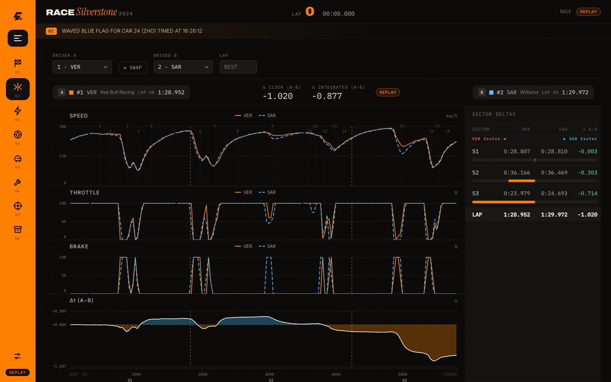 | 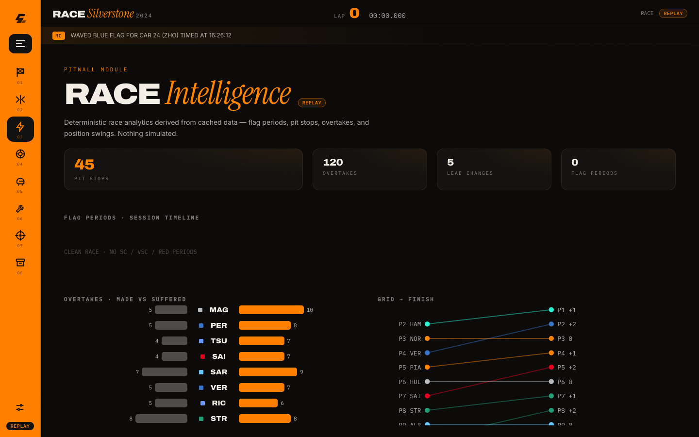 |

| Strategy Lab | Driver Lab | Prediction Arena |
|---|---|---|
| 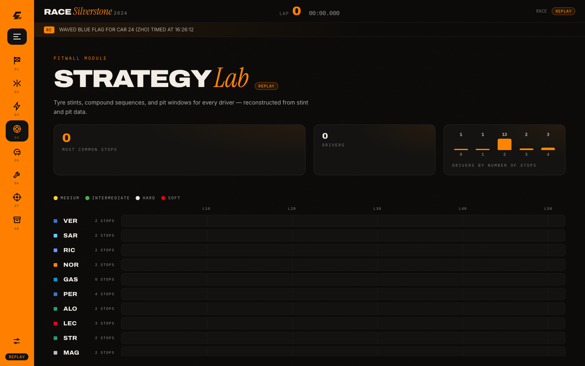 | 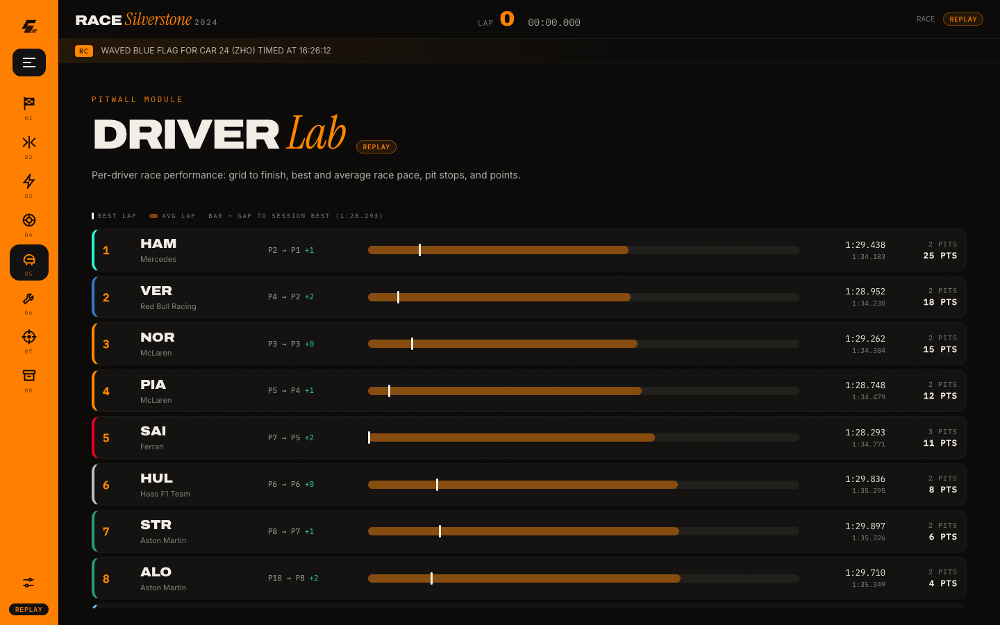 | 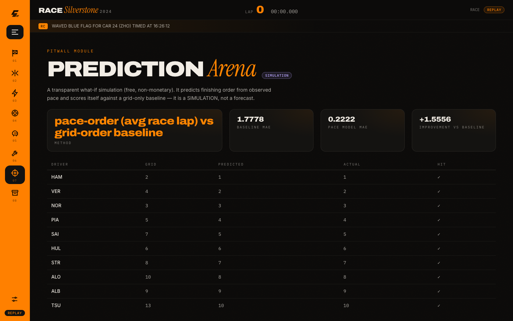 |

| Constructor Lab | Race Vault | Landing |
|---|---|---|
| 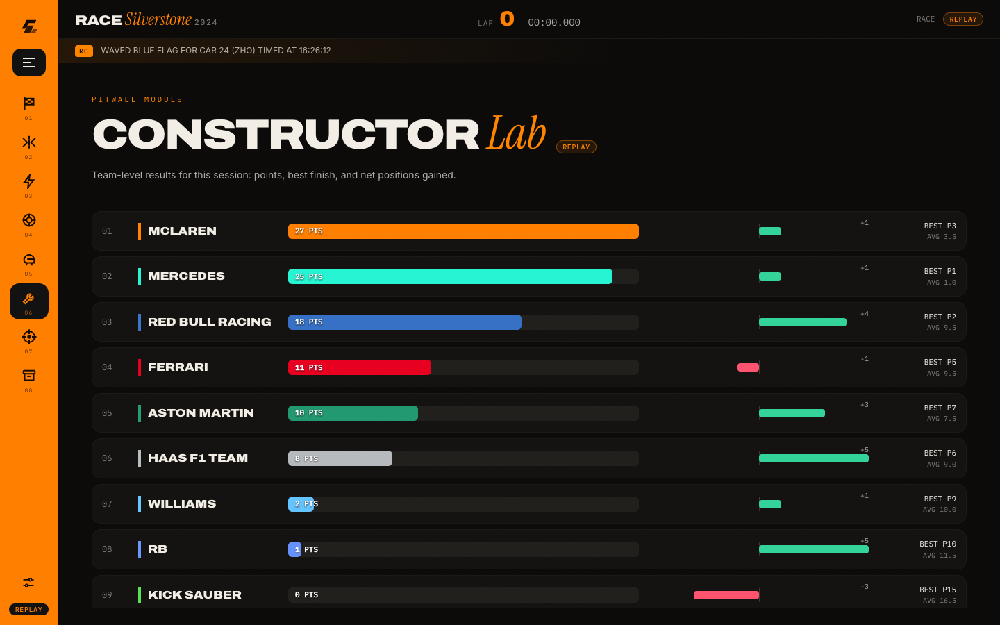 | 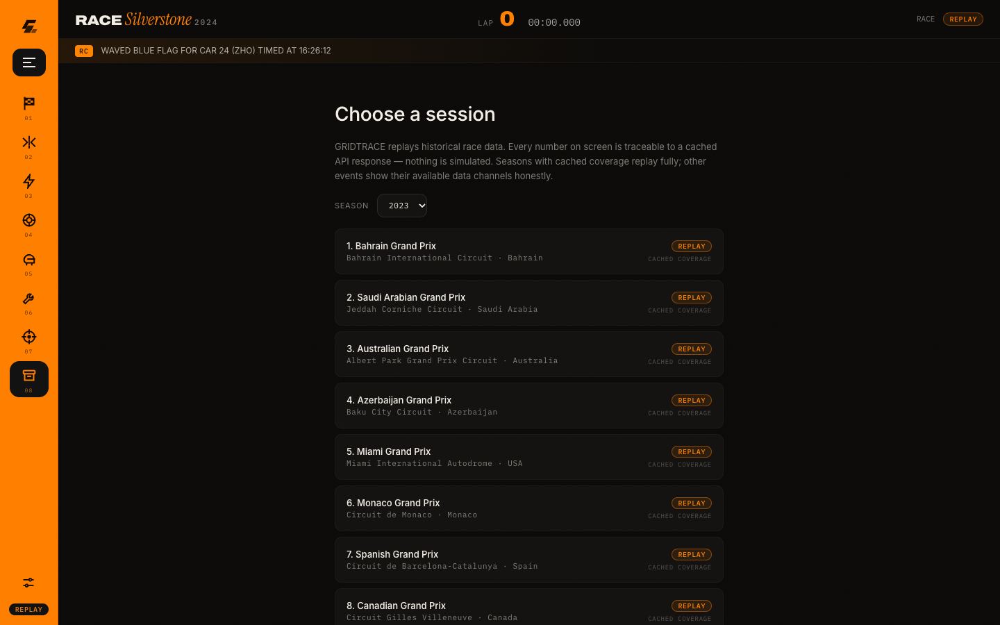 |  |

## Engines

Every analytical view is a **pure transformation of cached API responses** — no engine invents numbers, interpolates across red flags, or smooths missing telemetry. Full specs with source line references: **[docs/ENGINES.md](docs/ENGINES.md)**.

| Engine | Endpoint | Emits |
|--------|----------|-------|
| Session store | — | In-memory precomputed index (Build 18: ~65× faster warm `/state`) |
| State@t | `GET /api/session/{key}/state?t=…` | Timing tower, flag state, car markers at any instant |
| Race Intelligence | `/intelligence` | Flag periods, pit aggregates, overtakes, position movers, lead changes |
| Strategy Lab | `/strategy` | Stint timeline, stop count, tyre allocation (`REPLAY`) |
| Driver / Constructor Lab | `/driver-lab`, `/constructor-lab` | Pace, consistency, points, positions gained |
| Battle Lab | `/session/{key}/telemetry` | Distance-aligned speed/throttle/brake + Δt; honest 404 |
| Prediction Arena | `/prediction` | Deterministic pace-based what-if — always labelled `SIMULATION` |
| Diagnostics | `/diagnostics` | Dataset coverage + cache health per session |

## Status

| Build | Date | What shipped | Docs |
|-------|------|--------------|------|
| 0 | 2026-10-18 | Repo init, full docs skeleton, data-source verification (OpenF1 + Jolpica + MultiViewer), Python env working | [BUILD_LOG](docs/BUILD_LOG.md#build-0) |
| 1 | 2026-10-18 | Vite+React+TS scaffold, design tokens, zustand shared race clock, FastAPI skeleton + Pydantic contracts, test harnesses (pytest + Vitest) | [BUILD_LOG](docs/BUILD_LOG.md#build-1) |
| 2 | 2026-10-19 | Ingestion pipeline (fetch + normalize) for flagship Silverstone 2024, real-data API endpoints (sessions/drivers/state@t/race-control), state reconstruction, 12-test data QA suite, master design + landing directives | [BUILD_LOG](docs/BUILD_LOG.md#build-2) |
| 3 | 2026-10-19 | Full `--gt-*` tokens + self-hosted fonts, SIGNAL LAP landing at `/`, `/app` shell, Race Control board (110 real events), clock-driven timing tower (20 drivers, real gaps/tyres), replay controls (play/pause/speed/scrubber) | [BUILD_LOG](docs/BUILD_LOG.md#build-3) |
| 4 | 2026-10-19 | Public deploy on Vercel: FastAPI serverless API + SPA (`app.frontend()` CDN promotion, ADR-008); live at **https://gridtrace.vercel.app** | [BUILD_LOG](docs/BUILD_LOG.md#build-4) |
| 5 | 2026-10-19 | Track map (G1.7): per-driver location ingest (20 × 33,896 rows) → committed `locations.json`, `GET /circuit`, `markers`+`marker_mode` on state@t, SVG TrackMap with moving cars in Race Control (orientation +84.25°/flip-y, ADR-009); 22 backend tests | [BUILD_LOG](docs/BUILD_LOG.md#build-5) |
| 6 | 2026-10-19 | Battle Lab (G2.1): per-driver `car_data` ingest → distance-binned `telemetry.json` (ADR-011 units fix) → `GET /session/{key}/telemetry` (36 tests) → Battle Lab route — SVG speed/throttle/brake + Δt charts on a shared distance axis, sector-delta table, lap selector, honest 404 for missing telemetry | [BUILD_LOG](docs/BUILD_LOG.md#build-6) |
| 7 | 2026-10-19 | Art-direction resurrection starts: reconciliation layer (`ART_DIRECTION.md`, `UI_UX_SPECIFICATION.md`, rewritten `DESIGN_SYSTEM.md`, ADR-012) + procedural 3D single-seater asset (`SingleSeater3D.tsx`, three/R3F/drei) | [BUILD_LOG](docs/BUILD_LOG.md#build-7) |
| 8 | 2026-10-19 | Cinematic 3D landing hero: `--gt-scene-*` tokens + `--gt-scene` motion, lazy `HeroScene.tsx` (Three.js fog, key/rim lights, grid floor, 0.5s entrance), WebGL fallback to original SVG Signal Lap, scene caption | [BUILD_LOG](docs/BUILD_LOG.md#build-8) |
| 9 | 2026-10-19 | Spatial circuit stage (CSS-perspective SPATIAL/BLUEPRINT, FOLLOW/OVERVIEW camera, driver markers + turn labels, custom pitwall crosshair) + Race Ribbon timeline (event pins by semantic token + shape, expandable axis, speed/transport controls) replacing flat TrackMap + ReplayControls | [BUILD_LOG](docs/BUILD_LOG.md#build-9) |
| 10 | 2026-10-19 | 4-region app shell (rail 220px / session header / stage + timing table / ribbon spanning bottom) per master §10.3, deliberate session-selection screen (§10.2, never a marketing gate), selectable timing-tower rows + clickable editorial race-control events seek the shared clock, focus-visible rings on every new interactive surface (§20 microinteractions) | [BUILD_LOG](docs/BUILD_LOG.md#build-10) |
| 11 | 2026-10-19 | Visual acceptance gate (master §27): headless-Chrome (SwiftShader) 1440×900 capture of 6 screens + SPATIAL circuit-stage contrast fix (thicker track + lighter vignette); all 18 gate items inspected — **PASS with refinements** | [BUILD_LOG](docs/BUILD_LOG.md#build-11) |
| 12 | 2026-10-19 | **§28 final implementation report** (resurrection Task H): `docs/FINAL_REPORT.md` — what works, tests actually run, honest limitations, how to run; ADR-013 closes the art-direction task graph (Tasks A–H all complete) | [FINAL_REPORT](docs/FINAL_REPORT.md) |
| 13 | 2026-10-19 | Live banner + takeover docs (README, AGENTS.md, HANDOFF.md) | [BUILD_LOG](docs/BUILD_LOG.md#build-13) |
| 16 | 2026-10-20 | Award-reference landing redesign: boot → gate → main (REFERENCE_DESIGN_BRIEF) | [BUILD_LOG](docs/BUILD_LOG.md#build-16) |
| 17 | 2026-10-20 | Award-level landing: pinned-poster spine, full-bleed type, react-bits motion | [BUILD_LOG](docs/BUILD_LOG.md#build-17) |
| 18 | — | Replay-lag fix: in-memory pre-indexed session store (~65× faster warm `/state`) | [BUILD_LOG](docs/BUILD_LOG.md#build-18) |
| 19 | — | All-race catalog + capability detection, single-session lock removed | [BUILD_LOG](docs/BUILD_LOG.md#build-19) |
| 20 | — | SessionPicker wired to the all-race catalog | [BUILD_LOG](docs/BUILD_LOG.md#build-20) |
| 21 | — | Race Intelligence engine + chequered-flag red-flag substring bug fix | [BUILD_LOG](docs/BUILD_LOG.md#build-21) |
| 22 | — | Feature engines: Strategy, Driver Lab, Constructor Lab, Prediction, Diagnostics | [BUILD_LOG](docs/BUILD_LOG.md#build-22) |
| 23 | — | Full module UI: every nav item live | [BUILD_LOG](docs/BUILD_LOG.md#build-23) |
| 24 | — | Generalized ingest: any 2023+ session, `--no-tracking` core-only flag | [BUILD_LOG](docs/BUILD_LOG.md#build-24) |
| 25 | — | UI craft pass (app-screen rules) + production deploy | [BUILD_LOG](docs/BUILD_LOG.md#build-25) |
| 26 | — | Full UI rebuild from zero: the data-terminal world | [BUILD_LOG](docs/BUILD_LOG.md#build-26) |
| 27 | — | **"PIT WALL" rebuild:** broadcast shell, motion layer; `/` → `/app` | [BUILD_LOG](docs/BUILD_LOG.md#build-27) |
| 28 | — | three.js speed tunnel + kinetic session title (anime.js speed ramp) | [BUILD_LOG](docs/BUILD_LOG.md#build-28) |
| 29 | 2026-10-21 | Circuit-map fixes (per-circuit rotation, honest cars-on-track KPI), kinetic modules, bulk 2023–2025 core-only race ingest | [BUILD_LOG](docs/BUILD_LOG.md#build-29) |
| 30 | 2026-10-21 | Serverless bundle fix: restored proven `vercel.json` so `backend/data/**` (90 sessions) ships with the API | [BUILD_LOG](docs/BUILD_LOG.md#build-30) |

Builds 14–15 have no BUILD_LOG entry (hence the gap). "—" = build entry carries no date.

**Merge (Vairaj, post-Build 29):** a parallel UI workstream landed as discrete commits — PitRail menu + custom icons, restored landing at `/landing` (page moves off `/`), canvas race renderer with helmet markers + follow cam, broadcast-neon track with real weather/day-night conditions, Strategy stint timeline, Intelligence flag timeline + slope charts, Driver/Constructor lab cards, garage scene with 3D props, app theme pass over the PIT WALL shell. Credits: [CREDITS.md](CREDITS.md) · design notes: [DESIGN.md](DESIGN.md).

## Data mode honesty

This is a **historical replay** platform. Every view is labelled with its data mode: `LIVE` / `REPLAY` / `ESTIMATE` / `SIMULATION` / `UNAVAILABLE`. We never fabricate numbers, and no `LIVE` badge appears without an actual live feed.

- **Coverage: OpenF1's free post-session API starts at 2023.** There is no 2015–2022 data through this pipeline — earlier seasons are unavailable and are never faked.
- **Catalog: 90 sessions, 2023–2025**, ingested core-only (`--no-tracking`) — laps, positions, timing, pit stops, stints, race control, weather, results. Enough for every analytical module; per-driver telemetry deliberately skipped for these (that pull is tens of GB).
- **Full map tracking on two flagships only:** session **9558** (2024 British GP / Silverstone) and **9090** (2023 Monaco GP Qualifying) carry per-driver location, so the circuit map shows moving car markers.
- **All other ingested sessions** replay fully in the timing tower, race control, and modules, but the circuit map shows **without car dots**, honestly labelled `UNAVAILABLE`.
- The Prediction Arena is a deterministic **`SIMULATION`** (pace-based what-if), never presented as a live forecast.
- Stale intervals report `stale_seconds` instead of pretending to be fresh; a driver without `car_data` returns an honest 404, not a synthetic trace.

## Quickstart

Production is already deployed (https://gridtrace.vercel.app); the steps below are for local development only.

```bash
# Backend (Python 3.14 + uv)
cd backend
uv venv --python 3.14 .venv
uv pip install --python .venv/bin/python -r requirements.txt

# Ingest a session — core-only (session-level data; enough for every module).
.venv/bin/python -m app.ingest.fetch --session <SESSION_KEY> --no-tracking
.venv/bin/python -m app.ingest.normalize

# Full tracking (per-driver car_data/location → map markers + Battle Lab) is
# only used for the two flagships: 9558 (2024 British GP) and 9090 (2023 Monaco Q)
.venv/bin/python -m app.ingest.fetch --session 9558

# Run API
.venv/bin/uvicorn app.main:app --reload --port 8000

# Tests (run from backend/ or repo root)
.venv/bin/pytest -q

# Frontend
cd frontend && npm install
npm run dev      # http://localhost:5173, /api proxies to :8000
npm test -- --run
npm run build && npm run lint
```

### API surface

Full endpoint table with source line references: **[docs/ENGINES.md](docs/ENGINES.md#12-endpoints-at-a-glance)**. Headline routes:

| Endpoint | Returns |
|----------|---------|
| `GET /api/health` | `{"status":"ok"}` |
| `GET /api/sessions` | All 90 ingested sessions |
| `GET /api/session/{key}/state?t=SECONDS` | Position/gap/tyre state at t + `markers`/`marker_mode` |
| `GET /api/session/{key}/race-control` | Race-control events (`REPLAY`) |
| `GET /api/session/{key}/intelligence` | Flags, pits, overtakes, movers, lead changes |
| `GET /api/session/{key}/strategy` | Stint timeline + stop strategy |
| `GET /api/session/{key}/telemetry?drivers=n1,n2&lap=best` | Distance-aligned telemetry compare (honest 404) |
| `GET /api/session/{key}/prediction` | Deterministic what-if grid (`SIMULATION`) |

## Docs map (read in this order)

1. [AGENTS.md](AGENTS.md) — rules for every agent working in this repo
2. [TASKS.md](TASKS.md) — task graph (P0 critical path first)
3. [docs/PRODUCT_SPEC.md](docs/PRODUCT_SPEC.md) — what we're building and why
4. [docs/ARCHITECTURE.md](docs/ARCHITECTURE.md) — system design, shared race clock
5. [docs/ENGINES.md](docs/ENGINES.md) — **engine specs**: every transformation, its data, its honesty limits
6. [docs/DATA_SOURCES_AND_PROVENANCE.md](docs/DATA_SOURCES_AND_PROVENANCE.md) — every API we tested, what worked, field schemas, research log
7. [docs/ART_DIRECTION_MASTER.md](docs/ART_DIRECTION_MASTER.md) — governing art-direction source (CARBON/CHALK/SIGNAL + DEPTH, tokens, modules, task graph §26, gate §27)
8. [docs/DESIGN_SYSTEM.md](docs/DESIGN_SYSTEM.md) — Digital Pitwall design system: full `--gt-*` token tables, type, components, motion, accessibility
9. [docs/UI_UX_SPECIFICATION.md](docs/UI_UX_SPECIFICATION.md) — 4-region layout, Circuit Stage, crosshair, Race Ribbon, components, states, breakpoints
10. [docs/BUILD_LOG.md](docs/BUILD_LOG.md) — how each build was done, step by step
11. [docs/DECISIONS.md](docs/DECISIONS.md) — ADRs (ADR-012 covers the Three.js usage)
12. [docs/FINAL_REPORT.md](docs/FINAL_REPORT.md) — final implementation report (what works, tests run, honest limitations)
13. [docs/SETUP.md](docs/SETUP.md) — dev environment setup
14. [docs/TESTING_AND_QA.md](docs/TESTING_AND_QA.md) — test strategy

(`docs/LANDING_PAGE_DIRECTIVE.md` remains as historical record; the landing was removed from `/` in Build 27 and later restored at `/landing` by the merge workstream above.)

## Screenshots

**PIT WALL Race Control** (Build 27 — sticky status bar + race-control ticker, KPI strip, timing tower, circuit stage with SpeedTunnel behind):

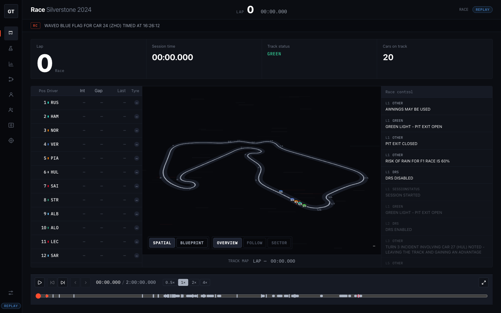

**SpeedTunnel** (Build 28 — three.js light-streak field behind the circuit map, speed-coupled to the replay clock):

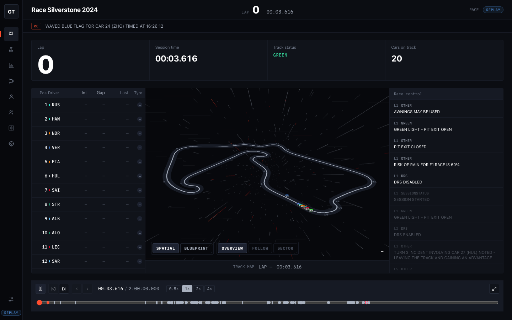

**Kinetic modules** (Build 29 — CountUp KPIs + bento stat grid on the module screens):

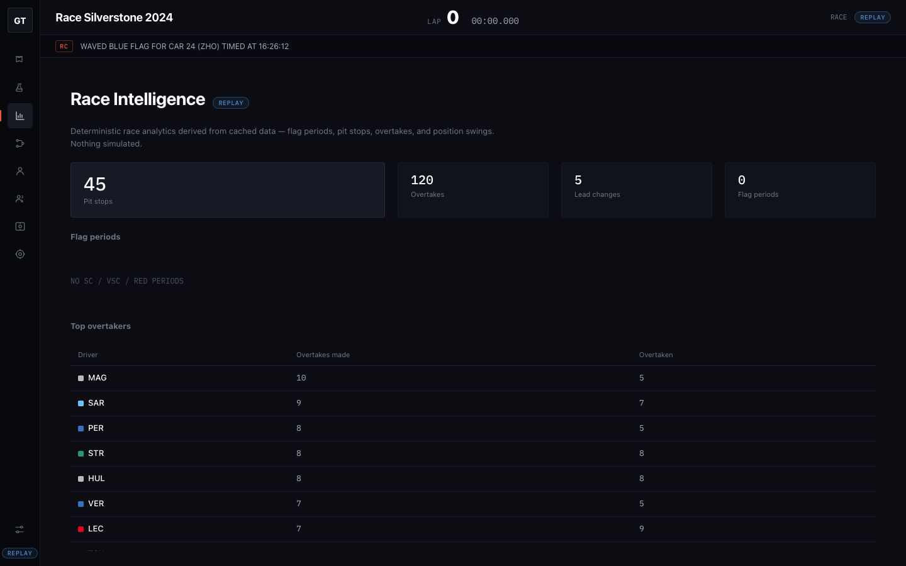

**Circuit-map fixes** (Build 29 — Monaco's correct shape via per-circuit rotation; Silverstone regression-checked):

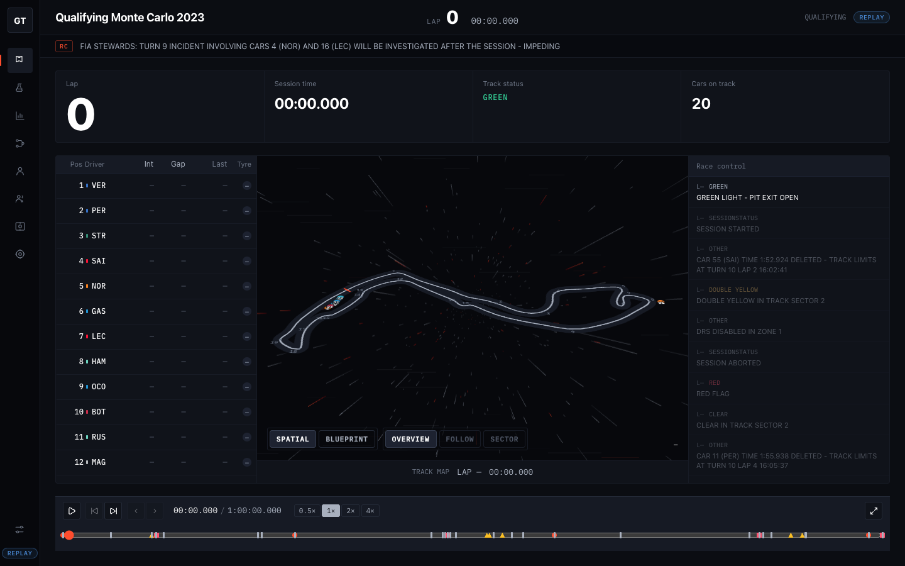
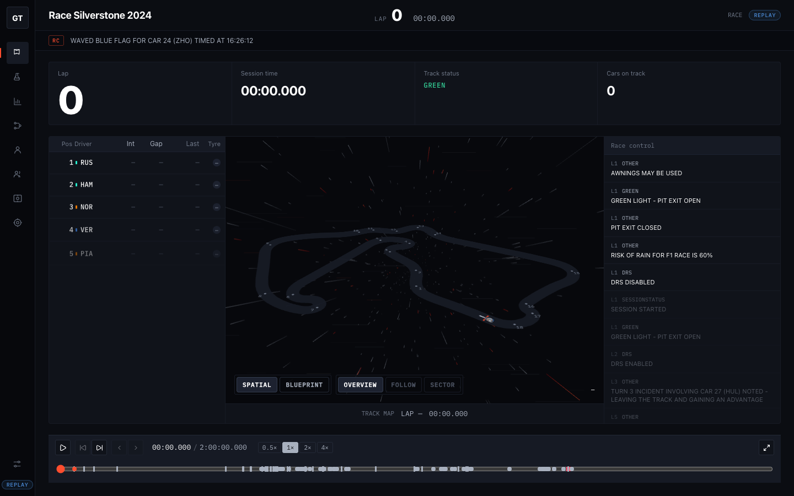

**Battle Lab** (Build 6 — two drivers on one distance axis, speed/throttle/brake + Δt charts, sector-delta table; `REPLAY` badge) and the **honest 404** (Gasly #10 has no `car_data`; the app says so instead of faking a trace):


**Race Control board with track map** (Build 5 — Silverstone outline, 18 corner labels, 20 driver markers at the grid t=0, `REPLAY` status row; pre-pit-wall UI):


Full historical sets in `docs/screenshots/`.

## Credits

- **UI/3D workstream** — Vairaj (PitRail, canvas race renderer, helmet markers, garage scene, landing restoration, module art passes). See [CREDITS.md](CREDITS.md).
- **3D models** — `papaya-f1.glb` is a modified "Ferrari F1-75" by Sketcher, **CC-BY-NC-4.0 (non-commercial only)**; `cone.glb` "Traffic Cone" by hinndia, CC BY 4.0; garage props are original in-code geometry. Full terms in [CREDITS.md](CREDITS.md).
- **UI components** — React Bits (Ferrofluid, Noise, Magnet, ClickSpark, ScrollVelocity, DecryptedText).
- **Visual references** — studied, not copied: landonorris.com, Dropbox × McLaren, Dribbble (Meher Ali, Koka Papaskua, aref karami, Renat Muratshin); light-reveal technique after rqphy/LightExperience.

## Data attribution / license

OpenF1 data © OpenF1 / their providers, free for historical use. Jolpica mirrors Ergast. MultiViewer circuit geometry for corner markers. All usage within each provider's terms — see [docs/DATA_SOURCES_AND_PROVENANCE.md](docs/DATA_SOURCES_AND_PROVENANCE.md).
